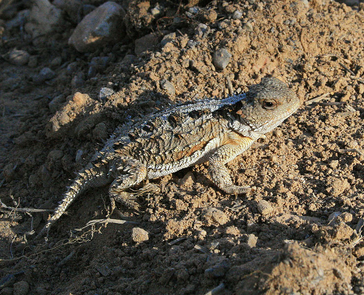
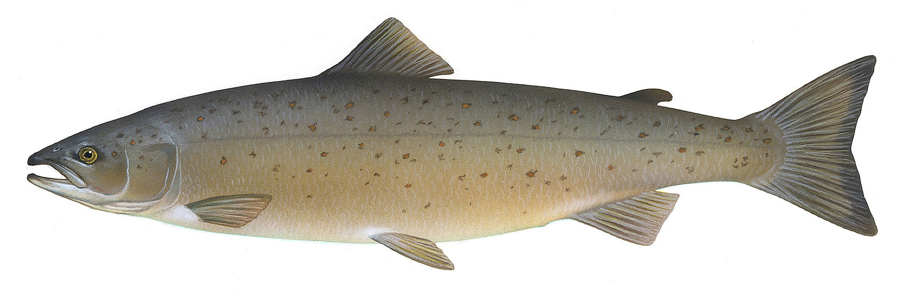
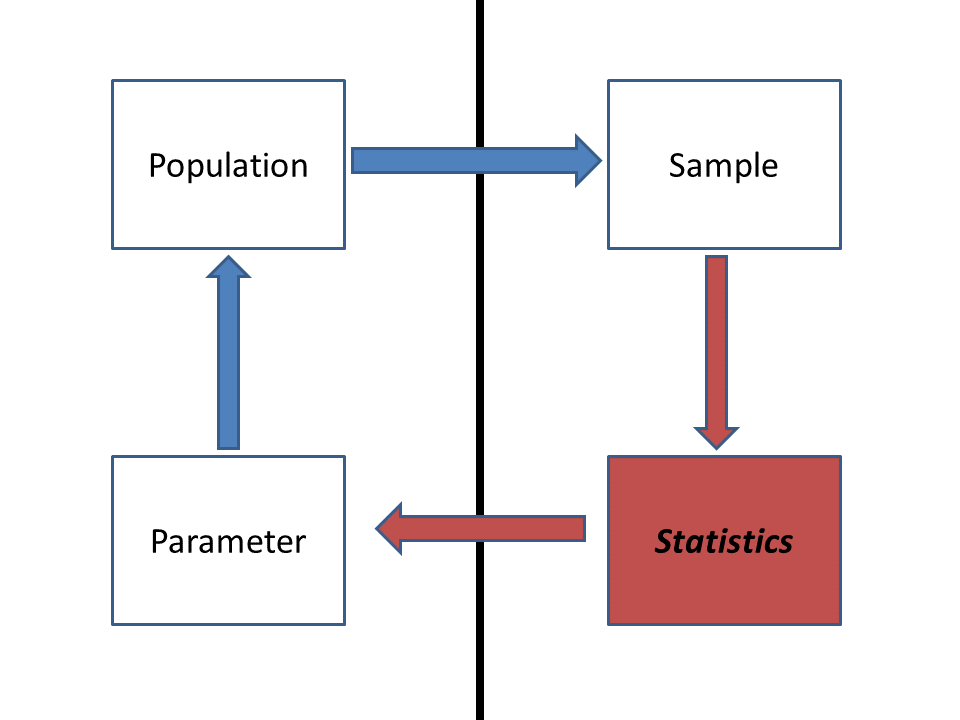

```{r setup, include=FALSE}
knitr::opts_chunk$set(echo = TRUE, warning = FALSE, message = FALSE,
                      fig.width = 7, fig.height = 4.5, fig.align = "center")

widget <- function(file) htmltools::includeHTML(file.path("widgets", file))
f2 <- function(v) formatC(round(v, 2) + 0, format = "f", digits = 2)
f3 <- function(v) formatC(v, format = "f", digits = 3)
```

```{r helpers, echo=FALSE}
# scientific workflow schematic; 'highlight' shades one box
draw_workflow <- function(highlight = NULL, cex = 0.9) {
  boxes <- c("PROBLEM", "THEORIES", "MODELS", "FIT", "COMPARE")
  subs <- c("what do we\nneed to know?", "candidate\nexplanations",
            "data-generating\n(process + noise)", "confront each\nwith data",
            "fit, prediction,\nrelevance")
  x <- seq(1, 9, by = 2)
  y <- 2
  w <- 0.8
  h <- 0.55
  shade <- function(lab) if (!is.null(highlight) && lab == highlight) "lightskyblue1" else "white"
  par(mar = c(0, 0, 0, 0))
  plot(NA, xlim = c(0, 10), ylim = c(-0.2, 4), axes = FALSE, xlab = "", ylab = "")
  for (i in seq_along(boxes)) {
    rect(x[i] - w, y - h, x[i] + w, y + h, col = shade(boxes[i]), lwd = 1.5)
    text(x[i], y + 0.18, boxes[i], font = 2, cex = cex)
    text(x[i], y - 0.22, subs[i], cex = cex * 0.75)
  }
  arrows(x[-5] + w, y, x[-1] - w, y, length = 0.08, lwd = 1.5)
  rect(6 - 0.7, 3.2 - 0.35, 6 + 0.7, 3.2 + 0.35, lty = 2, lwd = 1.5)
  text(6, 3.28, "DATA", font = 2, cex = cex)
  text(6, 3.0, "study design", cex = cex * 0.75)
  arrows(x[3], y + h, 6 - 0.7, 3.2, length = 0.08, lty = 2, lwd = 1.2)
  arrows(6 + 0.7, 3.2, x[4], y + h, length = 0.08, lty = 2, lwd = 1.2)
  segments(x[5], y - h, x[5], 0.4, lwd = 1.5)
  segments(x[5], 0.4, x[1], 0.4, lwd = 1.5)
  arrows(x[c(1, 2)], 0.4, x[c(1, 2)], y - h, length = 0.08, lwd = 1.5)
  text(6, 0.15, "REVISE the problem and theories; drop or down-weight poor models",
       cex = cex * 0.85, font = 3)
}
```

R code from this page is also in the
[companion script](lecture_notes/CODE_Week1_IntroAndAlgorithms.R).
Only base R is needed.

This material follows Bolker, *Ecological Models and Data in R*,
chapter 1 (pp. 1-35), especially analytical vs. computational models
(1.3.2, p. 9), and appendix A on algebra and calculus (A.1-A.4,
pp. 480-482).

# What this course is about {#intro}

This course is about learning to build statistical models from the
ground up, from basic principles, so they fit your question instead of
reshaping your question to fit a standard test. That means writing down
how you think the data were generated, fitting that model, and checking
it against rivals. This part gives the map
for the semester, describes how the course runs, and works through the
self-diagnostic warm-up.

## 1. Big picture

```{r workflow-course, echo=FALSE, fig.height=2.8, dev="png", dpi=250}
draw_workflow()
```

Most statistics courses teach a menu of tests: pick the one whose
assumptions match your data, run it, report a p-value. That works until
your data break the assumptions or your question isn't on the menu.
Here we work from the other end. Every analysis starts with a
**problem** (often a management or conservation question) and a set of
**theories** that could explain the pattern. Each theory becomes a
**model** with two parts: a deterministic function for the expected
response and a probability distribution for the scatter around it. We
**fit** each model to data, **compare** the fits, and **revise** the
problem and the theories based on what we learn.

The semester follows this loop. Early weeks build the parts of a model
(deterministic functions, probability, simulation); the middle of the
semester covers fitting (likelihood, optimization, Bayesian inference
and MCMC); later weeks cover comparing models and models for messier
data (hierarchical, correlated, and nonlinear structure). Along the way,
think of this as a course about playing: with data, with models, and
with probability. Simulating data from a model you wrote yourself, and
seeing whether you can get its parameters back, is one of the best ways
to learn what a model can and can't tell you.

## 2. How the course runs {#course}

- **Lectures** follow a web page like this one, one per week. Each
  lecture opens with a **WOD** ("workout of the day"), a short warm-up
  problem you work alone and then compare with a neighbor. WODs aren't
  graded for correctness, but to get participation credit you need to
  at least try each question. If you're completely lost, use the space
  to explain what confuses you and any other thoughts that come up.
  Struggle is a good thing, but write it down.
- **Labs** (2 hours 45 minutes, and we use all of it) are split into
  Acts. In each Act you work alone first, then compare and revise with
  your group. Getting something wrong on the first try is expected; the
  group discussion is where most of the learning happens. Lab handouts
  mix closed-laptop and open-laptop work.
- **What to bring:** a notebook and pen or pencil to lectures; a
  laptop as well (plus the notebook and pen) to labs.
- **Final projects** use your own data (or data you find). Everyone
  pitches a project, and groups form around the strongest pitches.
- **Textbook:** Ben Bolker, *Ecological Models and Data in R*. It's
  getting older (we'll point out where it shows its age), but it's still
  the textbook most aligned with this course's philosophy. Reading the
  relevant chapters before class is your main homework: you'll get much
  more out of class if you read (and reread) them first and note what
  confuses you. Be warned that the book won't all click together until
  chapter 6 (likelihood). Other readings are on WebCampus.
- **R:** install R and RStudio. We won't spend much time teaching R, but
  you should be able to load and plot data, run an analysis, and write a
  simple loop or function. The [links page](Links.html) has references,
  and [below](#skills) are the R skills worth practicing.
- **AI tools:** use them freely outside class. In class, keep them
  closed unless a handout says otherwise. Coding questions say whether
  AI is recommended, and you note how you used it.
- **Questions:** if something doesn't make sense, stop the lecture and
  ask. That's a problem with the explanation, not with you. For
  analysis questions outside class, the UNR
  [Stats Chats](https://guides.library.unr.edu/StatsChats) sessions are
  a good place to talk with other grad students and faculty.
- **Missing class:** time together in class is precious, so keep
  absences to a minimum, but we can be flexible about field work and
  other conflicts. Let the instructor know in advance, and send an
  email even if you've already mentioned it in person, so there's a
  written record. Get notes from a classmate.
- **A new structure:** the course has been overhauled for AI tools,
  which are changing quantitative modeling and statistical analysis.
  The core content and philosophy are largely unchanged, but the
  structure is new. If something isn't working for you, say so, and it
  will be adjusted.

**What to expect.** Come to class with an open mind, prepared to think,
struggle a little, and engage with challenging material. You may know
the Dunning-Kruger effect: people just starting a topic often feel more
expert than they are, then lose confidence as they see how much there
is to learn, and only then begin the long (and rewarding) climb toward
real expertise. This course aims to carry you through a good part of
that path: past the false peak, through the dip (you may stay there a
while), and onto the path of lifelong learning where real scientific
discoveries happen.

## 3. WOD: a self-diagnostic {#wod-diagnostic}

The first WOD was a [self-diagnostic](wod/WOD_Week1_Lecture1_Diagnostic.pdf)
of the math, statistics, probability, and R that the course builds on.
The goal isn't getting the right answers; it's for you to know which
skills you might want to dust off. For many people that's calculus.
This isn't a math class, but a little calculus helps a lot when working
with functions and probability distributions, and 3Blue1Brown's
[Essence of Calculus](https://www.3blue1brown.com/lessons/essence-of-calculus)
videos are a good place to start. Here are the answers, with a little R
where it helps.

**Logs and exponents.** $2^x = 32$ gives $x = 5$. For growth
$N_t = N_0 e^{rt}$ with $N_0 = 100$ and $N_8 = 550$, divide and take
natural logs: $r = \ln(550/100)/8$.

```{r wod-growth}
log(550 / 100) / 8
```

**Derivatives and integrals.** $f(x) = (4x^2 - 3x)^5$ is a function
inside a function, so the chain rule applies: the outer derivative
times the inner one,

$$f'(x) = 5(4x^2 - 3x)^4 (8x - 3).$$

At $x = 1$ the inner function is 1, so $f'(1) = 5 \cdot 1 \cdot 5 = 25$:
the curve is rising there, about 25 units of $f$ per unit of $x$. R's
`D()` gives the same derivative:

```{r wod-deriv}
fprime <- D(quote((4 * x^2 - 3 * x)^5), "x")
fprime
eval(fprime, list(x = 1))
```

For a recruitment rate $r(t) = 4t$, an antiderivative is
$R(t) = 2t^2$, so the total recruits from $t = 0$ to 5 is
$R(5) - R(0) = 50$. `integrate()` does it numerically:

```{r wod-integral}
integrate(function(t) 4 * t, lower = 0, upper = 5)
```

**Probability.** $P(A \text{ or } B) = P(A) + P(B) - P(A \text{ and } B)
= 0.4 + 0.5 - 0.2 = 0.7$ (subtract the overlap, or it's counted twice).
For two children with at least one girl, the equally likely families
are GG, GB, BG, and BB. The condition rules out BB, leaving three, so
$P(\text{both girls}) = 1/3$, not 1/2. A quick simulation agrees:

```{r wod-girls}
set.seed(1)
kids <- matrix(sample(c("G", "B"), 2e5, replace = TRUE), ncol = 2)
at_least_one <- kids[, 1] == "G" | kids[, 2] == "G"
both <- kids[, 1] == "G" & kids[, 2] == "G"
mean(both[at_least_one])
```

**Confidence intervals and p-values.** Both answers were (b). A 95%
confidence interval comes from a procedure that captures the true mean
in about 95% of repeated samples; any one interval either contains it or
doesn't. A p-value is the probability of a result at least as extreme as
the one observed, computed assuming the null hypothesis is true. It is
not the probability that the null is true.

**R.** Three snippets, one bug each:

```{r wod-bugs}
site_data <- matrix(c(12, 7, 19, 4, 45, 23, 61, 15), nrow = 4, ncol = 2)
site_data[2]          # the 2nd element, counting down the columns
site_data[, 2]        # the whole 2nd column

values <- c(10, 20, 30, 40)
doubled <- numeric(length(values))
for (i in seq_along(values)) {     # loop over positions 1 to 4, not values 10 to 40
  doubled[i] <- values[i] * 2
}
doubled

get_range <- function(x) {         # braces keep all three lines inside the function
  max_val <- max(x)
  min_val <- min(x)
  max_val - min_val
}
get_range(values)
```

Looping over `values` itself would set `i` to 10, 20, 30, and 40, and
R would quietly grow `doubled` to 40 elements, mostly `NA`. Without the
braces, only `max_val <- max(x)` belongs to the function.

## Discussion

1. A study reports a 95% confidence interval of 0.42 to 0.61 for
   annual nest survival. A manager reads it as "there's a 95% chance
   true survival is between 0.42 and 0.61." Is that wrong, and would the
   distinction change any decision the manager makes?
2. Pick a question from your own research. Write the problem first
   (what decision or understanding is at stake?), then two theories
   that could explain the pattern you expect. Would the two theories
   predict different data?

# Math tools for Lab 1 {#lab1}

Lab 1 uses rules for exponents and logarithms, derivatives built with
the product and chain rules, and the idea that the area under a rate
curve is a total. These are reminders of material from calculus, worked
on examples that differ from the lab's. The reasoning matters more than
memorizing formulas: each rule here follows from a picture or from a
rule before it.

## 1. Big picture

Ecological models are built from a small set of mathematical pieces.
Exponentials describe growth and decay; logarithms undo them and turn
multiplication into addition; derivatives say where a curve rises,
falls, or peaks; integrals add up a rate into a total. Bolker's appendix
A (pp. 480-482) summarizes all of these.

## 2. Exponents and logarithms {#logs}

The exponent rules:

$$x^a x^b = x^{a+b} \qquad \frac{x^a}{x^b} = x^{a-b} \qquad (x^a)^b = x^{ab}
\qquad x^{-a} = \frac{1}{x^a} \qquad x^0 = 1.$$

The last one follows from the second: $x^a/x^a = x^{a-a} = x^0$, and
anything divided by itself is 1.

A logarithm answers the question "what power?" $\log_b(x)$ is the
exponent you raise $b$ to in order to get $x$: $\log_{10}(1000) = 3$
because $10^3 = 1000$. Every log rule is an exponent rule read
backwards:

$$\log(xy) = \log x + \log y \qquad \log(x/y) = \log x - \log y \qquad
\log(x^k) = k\log x \qquad \log(1) = 0.$$

Some examples:

$$\log_{10}(2) + \log_{10}(50) = \log_{10}(100) = 2 \qquad
\log_{10}(500) - \log_{10}(5) = \log_{10}(100) = 2 \qquad
\log_{10}(3^4) = 4\log_{10}(3).$$

```{r log-examples}
log10(2) + log10(50)
log10(500) - log10(5)
c(log10(3^4), 4 * log10(3))
```

In R, `log()` is the natural log (base $e$) and `log10()` is base 10.
For a power of ten, $\log_{10}$ counts the zeros; for any other number
it gives the order of magnitude: $\log_{10}(7{,}000{,}000) \approx
`r f2(log10(7e6))`$, so the number is in the millions. That is why
ecologists plot body sizes, population sizes, and likelihoods on log
scales: equal distances on a log axis are equal multiplicative factors.

**Turning a curve into a line.** Logs can turn a curved relationship
into a straight one. Metabolic rate $B$ often scales with body mass $M$
as a power law, $B = aM^b$ with $b$ near 0.75. Take $\log_{10}$ of both
sides:

$$\log_{10} B = \log_{10} a + b \log_{10} M.$$

On a log-log plot, the power law is a line with slope $b$ and intercept
$\log_{10} a$.

```{r power-law, fig.width=9, fig.height=3.6}
mass <- c(1, 10, 100, 1000)
rate <- 3 * mass^0.75
data.frame(mass, rate = round(rate, 1), log10_rate = round(log10(rate), 3))

par(mfrow = c(1, 2), mar = c(4, 4, 2, 1))
curve(3 * x^0.75, from = 1, to = 1000, lwd = 2, xlab = "Body mass, M",
      ylab = "Metabolic rate, B", main = "Original scale")
curve(3 * x^0.75, from = 1, to = 1000, lwd = 2, log = "xy",
      xlab = "Body mass, M (log scale)", ylab = "B (log scale)",
      main = "Log-log scale")
```

> **Question:** In the table, how much does $\log_{10} B$ rise for each
> tenfold increase in mass? What would a slope of exactly 1 on the
> log-log plot mean biologically?

## 3. Derivatives: the power, product, and chain rules {#derivatives}

A derivative is a rate of change: how much a function's output changes
per unit change in its input, in the limit of a very small change.

**Power rule:** $\dfrac{d}{dx}x^n = n x^{n-1}$. Picture $x^2$ as the area
of a square with side $x$. Grow the side by a small amount $dx$. The area
gains two strips of area $x \, dx$ and a small corner of area $dx^2$.
As $dx$ shrinks, the corner shrinks faster than the strips, so the
change in area per unit change in side approaches $2x$.

**Product rule:** $\dfrac{d}{dx}(uv) = u'v + uv'$. The same picture
with a rectangle whose width $u$ and height $v$ grow at different rates.
The new area is the old one plus a strip $v\,du$ on the side, a strip
$u\,dv$ on top, and a corner $du\,dv$ that vanishes in the limit. The
power rule is the special case $u = v = x$.

```{r widget-rectangle, echo=FALSE}
widget("growing_rectangle.html")
```

> **Question:** In square mode, set $x = 3$ and slide $dx$ from 1.5 down
> to 0.1. What happens to the corner's share of the change in area? Why
> can we drop the corner when finding the derivative, but not when
> computing the exact new area?

**Chain rule:** $\dfrac{d}{dx}f(g(x)) = f'(g(x))\, g'(x)$. Rates
multiply through a composition: if you bike 3 times as fast as you walk
and walk 2 times as fast as you crawl, you bike 6 times as fast as you
crawl. For exponentials, the outer function is its own derivative, so

$$\frac{d}{dx} e^{g(x)} = g'(x)\, e^{g(x)}.$$

**Putting them together.** Take $f(x) = x^2 e^{-x}$, a curve that rises
from zero and then decays. It is a product, $u = x^2$ and
$v = e^{-x}$, with $u' = 2x$ and $v' = -e^{-x}$ (chain rule, inner
derivative $-1$):

$$f'(x) = 2x e^{-x} - x^2 e^{-x} = x(2 - x)e^{-x}.$$

The derivative is zero where any factor is zero. $e^{-x}$ is never
zero, so the critical points are $x = 0$ and $x = 2$. `D()` and
`optimize()` agree:

```{r product-chain, fig.width=6.5, fig.height=3.8}
D(quote(x^2 * exp(-x)), "x")
f <- function(x) x^2 * exp(-x)
optimize(f, interval = c(0, 10), maximum = TRUE)$maximum

curve(f(x), from = 0, to = 8, lwd = 2, ylim = c(-0.2, 0.6),
      xlab = "x", ylab = "")
curve(x * (2 - x) * exp(-x), add = TRUE, lty = 2, lwd = 2, col = "steelblue")
abline(h = 0, col = "grey60")
abline(v = 2, lty = 3)
legend("topright", c("f(x)", "f'(x)"), lty = 1:2, lwd = 2,
       col = c("black", "steelblue"), bty = "n")
```

The derivative crosses zero where $f$ peaks.

**The quotient rule comes free.** Write $u/v = u \cdot v^{-1}$. The
product rule, with the chain rule for $v^{-1}$ (derivative $-v^{-2}v'$),
gives

$$\frac{d}{dx}\left(\frac{u}{v}\right) = \frac{u'}{v} - \frac{uv'}{v^2}
= \frac{u'v - uv'}{v^2}.$$

Many saturating functions in ecology are ratios, so this is worth
having, but it is not a new idea.

## 4. Adding up a rate: a first look at integration {#integration}

A derivative turns a total into a rate. An **integral** turns a rate
into a total. If a predator captures prey at a constant 2 per day, it
captures $2 \times 5 = 10$ in five days: the area of a rectangle 5 days
wide and 2 per day tall. When the rate changes over time, the total is
still the area under the rate curve. For a rate that climbs steadily
from 0 to 4 per day over five days, the area is a triangle,
$\frac{1}{2}(5)(4) = 10$.

For curves that aren't straight lines, approximate the area with thin
rectangles and add them up (a Riemann sum). Thinner rectangles give a
better approximation:

```{r widget-accumulation, echo=FALSE}
widget("accumulation.html")
```

> **Question:** Choose the ramp and the left-edge rule. Is the sum too
> big or too small, and why? What changes with the right-edge rule? Why
> does the midpoint rule get the ramp right with any number of
> rectangles, but not the rise-and-fall curve?

**The fundamental theorem of calculus** says you don't always need the
rectangles. If $F$ is an antiderivative of $f$ (so $F' = f$), then

$$\int_a^b f(t)\,dt = F(b) - F(a).$$

For the ramp, $f(t) = 0.8t$. Running the power rule backwards (raise
the power by one, divide by the new power) gives $F(t) = 0.4t^2$, so the
total is $F(5) - F(0) = 0.4(25) = 10$, matching the triangle.

```{r ftc}
integrate(function(t) 0.8 * t, lower = 0, upper = 5)
F <- function(t) 0.4 * t^2
F(5) - F(0)
```

Integrals come back when we work with probability densities, where the
area under a curve is a probability.

# Algorithms for inference {#algorithms}

A statistical test answers a question like "could this pattern have
come from chance alone?" Some tests have a formula that gives the
answer directly. When no formula exists, or its assumptions don't fit,
you can get the answer by simulation: write down the chance process,
run it many times, and see how often it produces a pattern as extreme
as yours. This part works two examples, a z-test solved both ways and a
permutation test that has no formula at all.

## 1. Big picture

```{r workflow-compare, echo=FALSE, fig.height=2.8, dev="png", dpi=250}
draw_workflow("COMPARE")
```

The simplest comparison in the workflow is between the data and a
**null model**, a model in which the effect you care about is absent.
Bolker (1.3.2, p. 9) separates **analytical** models, solved with
algebra and calculus, from **computational** models, which are programs
you run to see what they do. Both kinds can answer the same question.
An analytical answer is exact and instant but exists only for problems
simple enough to solve on paper. A computational answer needs only an
understanding of how the data could have arisen, so it works for
problems no formula covers.

## 2. WOD: pseudocoding a permutation test {#wod-permutation}

The WOD ([handout](wod/WOD_Week1_Lecture2_PermutationPseudocode.pdf))
gave the body mass (g) of 10 pygmy short-horned lizards from a
cheatgrass-removal area (trtA) and 10 from an untreated area (Control):

{width=30%}

```{r lizard-data}
lizards <- data.frame(
  mass = c(175, 168, 168, 190, 156, 181, 182, 175, 174, 179,
           185, 169, 173, 173, 188, 186, 175, 174, 179, 180),
  group = rep(c("trtA", "Control"), each = 10)
)
group_means <- tapply(lizards$mass, lizards$group, mean)
group_means
observed_dif <- group_means[["trtA"]] - group_means[["Control"]]
observed_dif
```

**The test statistic** is the difference in group means,
`r observed_dif` g. **The alternative is two-tailed:** the question was
whether mass differs between the groups, with no direction predicted
in advance, so a difference of $+3.4$ would count as much evidence as
$-3.4$.

**The algorithm.** If the treatment has no effect, the labels "trtA"
and "Control" are arbitrary: any lizard could have carried either label.
So:

1. Compute the observed difference in means.
2. Many times: shuffle the 20 labels at random, recompute the
   difference in means for the shuffled groups, and store it.
3. The stored differences show what the statistic looks like when the
   labels mean nothing.
4. The p-value is the fraction of stored differences at least as far
   from zero as the observed one.

Section 4 turns this into R.

## 3. Two routes to a z-test {#ztest}

{width=30%}

Farm-raised Atlantic salmon on a conventional diet weigh about
Normal(4.5, 0.9) kg after a year. Ten fish raised on a new plant-based
diet were weighed. Do fish on the new diet weigh less? (A one-tailed
question: only lower mass counts as evidence.)

```{r salmon-data, fig.width=6.5, fig.height=3.8}
pop_mean <- 4.5
pop_sd <- 0.9
salmon <- c(3.14, 3.27, 2.56, 3.77, 3.34, 4.32, 3.84, 2.19, 5.24, 3.09)
n <- length(salmon)
sample_mean <- mean(salmon)
sample_mean

hist(salmon, freq = FALSE, breaks = seq(1.5, 7, by = 0.5), col = "grey85",
     xlim = c(1.5, 7), ylim = c(0, 0.6), main = "",
     xlab = "Body mass (kg)")
curve(dnorm(x, pop_mean, pop_sd), add = TRUE, lwd = 2, col = "firebrick")
abline(v = sample_mean, lwd = 3, col = "steelblue")
```

The red curve is the conventional-diet population; the histogram is the
new-diet sample, with its mean in blue. The question is about the
**sample mean**: how unusual is a mean of `r sample_mean` kg for 10 fish
drawn from the red population?

{width=50%}

We want to learn about a **population**, but we only see a **sample**.
A statistic computed from a sample (here, the mean) varies from sample
to sample. That **sampling variability** is what a test has to account
for.

**Route 1: analytical.** The means of samples of size $n$ from a
normal population are themselves normal, with the same mean and a
standard error of $\sigma/\sqrt{n}$. That gives the p-value in one line:

```{r salmon-analytical}
pop_se <- pop_sd / sqrt(n)
z <- (sample_mean - pop_mean) / pop_se
p_analytical <- pnorm(sample_mean, mean = pop_mean, sd = pop_se)
c(z = z, p = p_analytical)
```

This is the textbook z-test (the `BSDA` package's `z.test()` does the
same thing). It works because the problem was simple enough to solve
on paper: a known population standard deviation and a normal
population.

**Route 2: computational.** Suppose we had never heard of a standard
error. We still know the story: if the new diet does nothing, the 10
fish are a random sample from the conventional population. So draw such
samples, many times, and see how often their mean is as low as ours.

```{r salmon-simulation, fig.width=6.5, fig.height=3.8}
set.seed(746)
n_sims <- 100000
null_means <- numeric(n_sims)
for (i in seq_len(n_sims)) {
  fake_sample <- rnorm(n, mean = pop_mean, sd = pop_sd)
  null_means[i] <- mean(fake_sample)
}
p_simulated <- mean(null_means <= sample_mean)
p_simulated

hist(null_means, breaks = 60, col = "grey85", main = "",
     xlab = "Mean of 10 fish, simulated with no diet effect (kg)",
     xlim = range(c(null_means, sample_mean)))
abline(v = sample_mean, lwd = 3, col = "steelblue")
```

Out of `r format(n_sims, big.mark = ",")` simulated samples,
`r sum(null_means <= sample_mean)` had a mean at or below
`r sample_mean` kg, for a p-value of about `r signif(p_simulated, 2)`.
The formula said `r signif(p_analytical, 2)`. The two agree to within
simulation noise, and the simulation never used the standard-error
formula. The spread of the simulated means is
`r f3(sd(null_means))`, close to $\sigma/\sqrt{n} = `r f3(pop_se)`$: the
loop rediscovered the standard error on its own.

The tradeoff: the formula is exact and instant but needs assumptions
that let someone derive it; the loop is approximate and slower but
needs only a story you can simulate.

## 4. Shuffling labels: a permutation test {#permutation}

The lizard data have no known population to simulate from, and we don't
want to assume normality. The permutation test from the WOD builds the
null distribution from the data themselves, by shuffling the labels:

```{r lizard-permutation, fig.width=6.5, fig.height=3.8}
set.seed(746)
reps <- 10000
null_difs <- numeric(reps)
for (i in seq_len(reps)) {
  shuffled <- sample(lizards$group)
  null_difs[i] <- mean(lizards$mass[shuffled == "trtA"]) -
    mean(lizards$mass[shuffled == "Control"])
}
p_perm <- mean(abs(null_difs) >= abs(observed_dif))
p_perm

hist(null_difs, breaks = 40, col = "grey85", main = "",
     xlab = "trtA mean minus Control mean, labels shuffled (g)")
abline(v = c(observed_dif, -observed_dif), lwd = 3, col = "steelblue",
       lty = c(1, 2))
```

About `r round(100 * p_perm)`% of shuffles give a difference at least
as large as the observed `r abs(observed_dif)` g, in either direction.
A difference this size is common when the labels mean nothing, so these
data give no real evidence of a treatment effect.

Compare the two loops. Both compute a statistic, then repeat a random
step many times, recompute, and store, then ask how often the stored
values are as extreme as the observed one. Only the random step differs:
the salmon loop draws new data from an assumed population, while the
permutation loop reshuffles the data we have.

```{r widget-resampling, echo=FALSE}
widget("resampling.html")
```

> **Question:** For the salmon, add 1,000 replicates a few times. Many
> runs of 1,000 contain no simulated mean as low as 3.476. What p-value
> should you report from such a run? How many replicates would you need
> before you expect to see a few?

**Packaging the loop.** Once an algorithm works, wrap it in a function
so it runs on any data set with two groups:

```{r perm-function}
permutation_test <- function(value, group, reps = 10000) {
  labels <- unique(group)
  dif <- function(g) mean(value[g == labels[1]]) - mean(value[g == labels[2]])
  observed <- dif(group)
  null_difs <- numeric(reps)
  for (i in seq_len(reps)) {
    null_difs[i] <- dif(sample(group))
  }
  list(observed = observed, p_value = mean(abs(null_difs) >= abs(observed)))
}

set.seed(746)
permutation_test(lizards$mass, lizards$group)
```

For comparison, a two-sample t-test gives p =
`r f2(t.test(mass ~ group, data = lizards, var.equal = TRUE)$p.value)`.
The two agree here because the data look roughly normal. The
permutation test would still be valid if they weren't.

**Why bother with the loop?** It lets you run analyses that no
canned function offers, relax assumptions that a standard test forces
on you, and (because you have to write it) state those assumptions
explicitly. The same skeleton (a random step, recompute, store,
summarize) comes back throughout the semester: in
[simulating data from a model](Week5_SimulatingData.html), in
[power analysis](Week6_LikelihoodAndPowerAnalysis.html#power), and in
[Markov chain Monte Carlo](Week9_MCMC.html).

## 5. Tools that keep coming up {#skills}

Most of the rest of the course is new material, but the basic tools
from this week keep coming back, so keep reviewing them:

- intro statistics concepts, such as sampling distributions and
  confidence intervals;
- exponentials and logarithms;
- derivatives and integrals;
- R coding: iteration, functions, random number generators, and
  plotting data;
- writing algorithms (thinking like a computer).

For R, the best way to learn is probably just to get in there and code,
perhaps with an AI assistant for personalized guidance. The materials
from a recent [R bootcamp](https://kevintshoemaker.github.io/R-Bootcamp/)
are another place to start.

## Discussion

1. The salmon formula gave p = `r signif(p_analytical, 2)` and the
   simulation gave about `r signif(p_simulated, 2)` from
   `r format(n_sims, big.mark = ",")` replicates. When a formula and a
   simulation disagree in the second significant digit, which do you
   trust, and when would you trust the simulation over the formula?
2. The permutation test and the t-test both gave p near
   `r f2(p_perm)` for the lizards. Describe a data set where you'd expect
   them to disagree. What feature of the data would cause it?
3. Name a question from your own work where you understand how the data
   arise but can't name a test for it. What would the random step in
   your loop be?

## Bonus: bootstrapping a confidence interval {#bootstrap}

The same skeleton gives confidence intervals. R's built-in `trees` data
set has the girth, height, and volume of 31 black cherry trees. Which
predicts volume better, girth or height? $R^2$ from a simple regression
measures it, but nothing in base R puts a confidence interval on $R^2$.

```{r trees-rsq, fig.width=9, fig.height=3.6}
par(mfrow = c(1, 2), mar = c(4, 4, 1, 1))
plot(Volume ~ Girth, data = trees, pch = 16, col = "firebrick")
plot(Volume ~ Height, data = trees, pch = 16, col = "steelblue")

r_squared <- function(data, response = "Volume") {
  predictors <- setdiff(names(data), response)
  sapply(predictors, function(p) {
    summary(lm(reformulate(p, response), data = data))$r.squared
  })
}
r_squared(trees)
```

A **bootstrap** treats the sample as a stand-in for the population.
Resample the 31 trees with replacement (some trees appear twice, some
not at all), recompute $R^2$, and repeat. The spread of the bootstrap
values shows how much $R^2$ would vary from sample to sample:

```{r trees-boot}
set.seed(746)
boot_rsq <- t(replicate(2000, {
  rows <- sample.int(nrow(trees), replace = TRUE)
  r_squared(trees[rows, ])
}))
apply(boot_rsq, 2, quantile, probs = c(0.025, 0.975))
```

The 95% intervals don't overlap: girth is the better predictor, and
height's $R^2$ is far less certain. The random step this time is
resampling rows with replacement.
